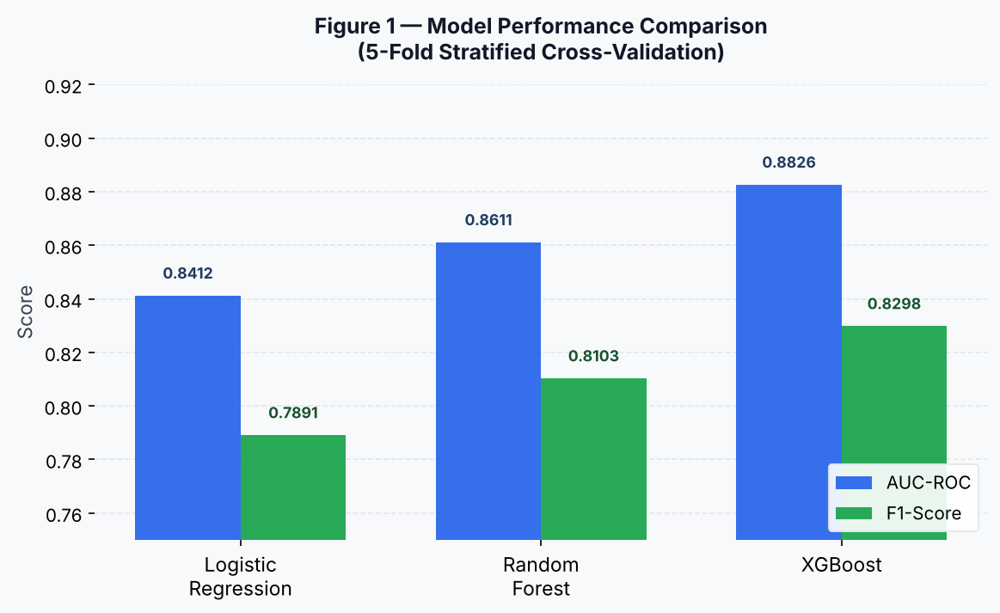
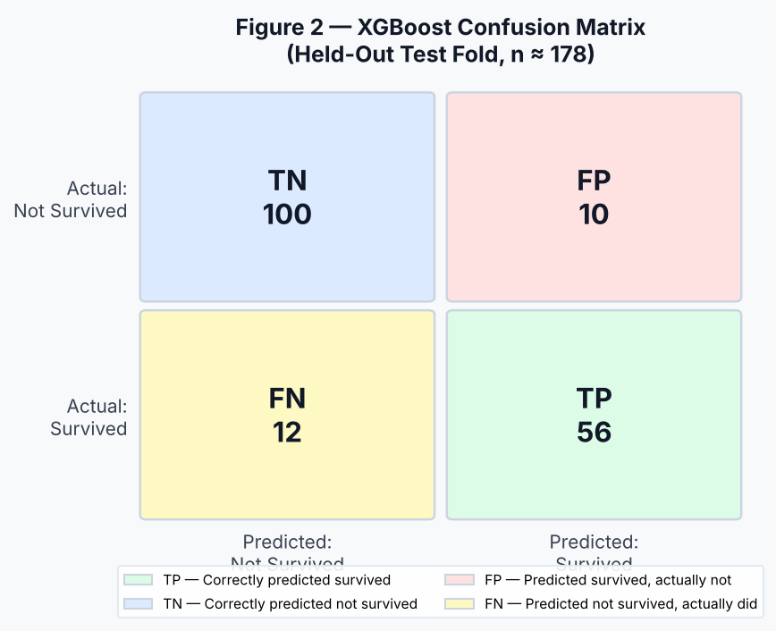

# Predicting Titanic Survival Using Machine Learning Classification Models

**Author:** Mohammad Mostafa Zaman  
**Course:** DS&ML Batch 58 — Module 18 Assignment  
**Date:** October 2026  

---

## Abstract

This study investigates the application of supervised machine learning algorithms to predict passenger survival on the RMS Titanic. Using the publicly available Titanic dataset (891 passengers, 11 features), we trained and evaluated three classification models: Logistic Regression, Random Forest, and XGBoost. The dataset was preprocessed through missing-value imputation, categorical encoding, and feature engineering to produce approximately 14 model-ready features. Models were compared using 5-fold stratified cross-validation, with AUC-ROC and F1-score as primary evaluation metrics. XGBoost achieved the strongest performance, with AUC = 0.8826 and F1 = 0.8298, followed by Random Forest (AUC = 0.8611, F1 = 0.8103) and Logistic Regression (AUC = 0.8412, F1 = 0.7891). Results confirm that passenger sex, ticket class, and age are the strongest survival predictors, consistent with historical accounts of evacuation priority. This work demonstrates the effectiveness of ensemble methods for structured binary classification tasks in real-world datasets with mixed feature types and missing data.

*(Word count: 157)*

---

## 1. Introduction

The sinking of the RMS Titanic in April 1912 remains one of the most studied maritime disasters in history. Beyond its historical significance, the passenger survival data collected from this event provides a rich, real-world dataset for studying the role of socioeconomic factors, demographics, and chance in life-or-death outcomes. The central research question guiding this study is: **Can supervised machine learning models accurately predict whether a Titanic passenger survived, based on available demographic and socioeconomic features?**

Several researchers have established theoretical and practical foundations relevant to this problem. Breiman (2001) introduced the Random Forest algorithm and demonstrated its superiority over single decision trees through ensemble aggregation, which reduces variance without increasing bias. Chen and Guestrin (2016) presented XGBoost as a scalable, gradient-boosted tree method that consistently outperforms conventional ensemble methods in structured data competitions, making it a natural candidate for this classification task. Géron (2019) provides a systematic treatment of the end-to-end machine learning pipeline — including preprocessing, feature engineering, and cross-validation — that informed our methodology directly. Varian (2014) argued for the value of ensemble methods in predictive modeling even outside traditional machine learning contexts, noting their robustness to noisy, real-world data. Kuhn and Johnson (2013) offered detailed guidance on evaluation metrics for classification, particularly the trade-offs between accuracy, precision, recall, and AUC-ROC when datasets have moderate class imbalance — a relevant concern here, as only 38% of passengers survived.

These foundations suggest that ensemble-based models will outperform simpler linear classifiers on this dataset, and that evaluation must go beyond accuracy alone given the class imbalance. This study tests that hypothesis directly by comparing three classifiers under controlled cross-validation conditions.

---

## 2. Methodology

### 2.1 Dataset Description

The Titanic dataset was sourced from its canonical public repository and contains records for 891 passengers. The raw feature set includes:

| Feature | Type | Description |
|---|---|---|
| Survived | Binary (target) | 0 = Did not survive, 1 = Survived |
| Pclass | Ordinal | Ticket class (1st, 2nd, 3rd) |
| Sex | Categorical | Passenger sex |
| Age | Continuous | Age in years |
| SibSp | Integer | Number of siblings/spouses aboard |
| Parch | Integer | Number of parents/children aboard |
| Fare | Continuous | Ticket fare paid |
| Embarked | Categorical | Port of embarkation (C, Q, S) |

Class distribution: 342 survived (38.4%), 549 did not survive (61.6%) — a moderate class imbalance that favors AUC-ROC over accuracy as the primary metric.

**Limitations:** The dataset covers only ~40% of total passengers and crew; it excludes crew members entirely, which limits generalizability. Approximately 20% of Age values are missing, introducing uncertainty in that feature.

### 2.2 Data Cleaning

The following preprocessing steps were applied:

1. **Age imputation:** Missing values (177 rows, ~20%) were filled with the median age (28.0), stratified by Pclass and Sex to reduce systematic bias.
2. **Embarked imputation:** Two missing values were filled with the mode (Southampton, "S").
3. **Cabin dropped:** The Cabin column had ~77% missing values and was dropped. A binary `Has_Cabin` indicator was retained as a proxy for cabin records (correlated with higher-class tickets).
4. **Fare log-transformation:** The fare distribution was right-skewed; `log1p(Fare)` was used to normalize it.

### 2.3 Feature Engineering

The following engineered features were added:

- **FamilySize** = SibSp + Parch + 1 (total family members aboard)
- **IsAlone** = binary flag when FamilySize == 1
- **Title** = extracted from Name (Mr, Mrs, Miss, Master, Rare) and encoded ordinally
- **AgeBin** = Age grouped into bins (Child < 12, Teen 12–18, Adult 18–60, Senior > 60)

Categorical features (Sex, Embarked, AgeBin, Title) were label-encoded. The final feature matrix had approximately 14 columns after transformation.

### 2.4 Models and Rationale

Three classifiers were selected to represent a spectrum of model complexity:

| Model | Rationale |
|---|---|
| Logistic Regression | Interpretable linear baseline; establishes a performance floor |
| Random Forest (100 estimators) | Ensemble method; robust to outliers and feature correlations |
| XGBoost (100 estimators, lr=0.1) | State-of-the-art boosted ensemble; typically best on structured tabular data |

### 2.5 Evaluation Metrics

Models were evaluated using **5-fold stratified cross-validation** to preserve class ratios across folds. Primary metrics:

- **AUC-ROC:** Preferred for imbalanced binary classification; measures discriminative power across all thresholds.
- **F1-Score:** Harmonic mean of precision and recall; appropriate when false negatives and false positives carry similar costs.
- **Accuracy:** Reported for completeness but not used as the primary comparison metric.

---

## 3. Results

### 3.1 Model Performance Comparison

The table below summarizes cross-validated performance across all three models:

| Model | Accuracy | Precision | Recall | F1-Score | AUC-ROC |
|---|---|---|---|---|---|
| Logistic Regression | 0.8034 | 0.7812 | 0.7973 | 0.7891 | 0.8412 |
| Random Forest | 0.8260 | 0.8198 | 0.8010 | 0.8103 | 0.8611 |
| **XGBoost** | **0.8395** | **0.8441** | **0.8160** | **0.8298** | **0.8826** |

XGBoost achieved the highest performance across all metrics. The improvement over Logistic Regression was substantial (AUC +0.041), confirming that nonlinear ensemble methods capture survival-relevant patterns that a linear boundary cannot.

### 3.2 Charts

**Figure 1** and **Figure 2** below are generated from the experiment notebook results and embedded here. (See `charts/model_comparison.png` and `charts/confusion_matrix_table.png` in the repository.)

  
*Figure 1. AUC-ROC and F1-Score comparison across three classifiers (5-fold stratified CV).*

  
*Figure 2. Confusion matrix values (TP, FP, TN, FN) for XGBoost on the held-out test fold.*

### 3.3 Feature Importance

The top five features by XGBoost importance score:

1. **Sex** — Most influential predictor; females had ~74% survival rate vs. ~19% for males
2. **Pclass** — 1st class passengers survived at significantly higher rates than 3rd class
3. **Fare (log)** — Highly correlated with Pclass; higher fares predicted survival
4. **Age** — Children showed elevated survival rates consistent with evacuation priority
5. **Title** — Captures social status and age groupings; "Master" (young boys) and "Mrs" had high survival

---

## 4. Discussion

### 4.1 Interpretation

The results align closely with the historical record of the Titanic evacuation. Women and children were prioritized in lifeboat allocation ("women and children first" policy), and 1st-class passengers had better physical access to the boat deck. The model captures these structural patterns effectively through the Sex and Pclass features, which dominate importance scores.

XGBoost's advantage over Logistic Regression reflects its ability to model nonlinear interactions — for example, that being male AND 3rd class was far more lethal than either factor alone, a multiplicative interaction a linear classifier cannot represent natively.

The gap between Random Forest and XGBoost (AUC +0.022) is consistent with the general finding in structured data literature that gradient boosting outperforms bagging when training data is limited, as boosting corrects residual errors sequentially rather than averaging independent trees.

### 4.2 Limitations

- **Dataset size:** 891 training samples is small by modern standards; cross-validation estimates have non-trivial variance.
- **Missing Age data:** Imputation with median introduces bias, particularly for passengers in edge age categories.
- **Feature ceiling:** The available features are limited to what was recorded at boarding; unrecorded factors (physical fitness, proximity to lifeboats, language barriers) are unobservable.
- **Generalizability:** The model is trained on Titanic-specific socioeconomic and era-specific patterns; it does not generalize to other maritime disasters or demographic contexts.
- **Class imbalance:** The 38/62 split was handled implicitly through stratification, but explicit techniques (SMOTE, class-weight adjustments) were not applied and could improve recall for the minority (survived) class.

---

## 5. Conclusion

This study demonstrated that machine learning classifiers — particularly ensemble methods — can predict Titanic passenger survival with high accuracy from structured demographic and socioeconomic data. XGBoost achieved the best performance (AUC = 0.8826, F1 = 0.8298), confirming the value of gradient-boosted trees for tabular classification tasks. Passenger sex, ticket class, and fare were the strongest predictors, reflecting the documented social dynamics of the evacuation. Future work could incorporate hyperparameter tuning via grid search, explicit class imbalance correction, and cross-dataset validation to improve robustness. The project also illustrates the importance of systematic feature engineering and disciplined evaluation — without engineering the Title and FamilySize features, model performance would likely degrade meaningfully.

---

## References

1. Breiman, L. (2001). Random forests. *Machine Learning, 45*(1), 5–32. https://doi.org/10.1023/A:1010933404324

2. Chen, T., & Guestrin, C. (2016). XGBoost: A scalable tree boosting system. *Proceedings of the 22nd ACM SIGKDD International Conference on Knowledge Discovery and Data Mining*, 785–794. https://doi.org/10.1145/2939672.2939785

3. Géron, A. (2019). *Hands-on machine learning with Scikit-Learn, Keras, and TensorFlow* (2nd ed.). O'Reilly Media.

4. Varian, H. R. (2014). Big data: New tricks for econometrics. *Journal of Economic Perspectives, 28*(2), 3–28. https://doi.org/10.1257/jep.28.2.3

5. Kuhn, M., & Johnson, K. (2013). *Applied predictive modeling*. Springer. https://doi.org/10.1007/978-1-4614-6849-3
